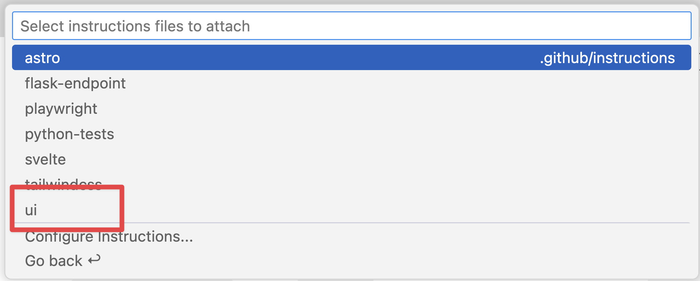

Incluso las actualizaciones más sencillas de una aplicación suelen requerir cambios en varios archivos y operaciones como ejecutar pruebas. El flujo habitual de desarrollo incluye localizar todos los archivos necesarios, aplicar los cambios, ejecutar pruebas, depurar, averiguar qué archivo falta y volver a modificarlo. Y así sucesivamente.

Para eso sirve el modo agente de Copilot.

El modo agente de Copilot funciona de forma más autónoma en el IDE. Se comporta de forma parecida a un desarrollador: explora la estructura del proyecto, aplica los cambios necesarios, ejecuta tareas como las pruebas y corrige automáticamente los problemas que encuentra. Vamos a utilizar el modo agente para añadir funcionalidad al sitio.

> [!NOTE]
> Aunque los nombres se parecen, el modo agente y el agente en la nube están diseñados para experiencias distintas. El modo agente trabaja en el IDE y permite ciclos rápidos de interacción y comentarios. El agente en la nube trabaja de forma asíncrona como un miembro del equipo y se comunica contigo mediante incidencias y solicitudes de incorporación de cambios.

En este ejercicio aprenderás cómo:

- el modo agente de Copilot explora el proyecto, identifica los archivos pertinentes y coordina los cambios.
- el modo agente de GitHub Copilot implementa funcionalidades en la interfaz y la capa de datos.
- revisar los cambios y las pruebas generados por el modo agente antes de incorporarlos al código base.

## Escenario

El catálogo de juegos está creciendo y quieres que los usuarios puedan filtrar por categoría y editorial. En el ejercicio anterior añadiste una función auxiliar para las editoriales; ahora completarás con el modo agente de Copilot el trabajo restante de la capa de datos, la interfaz y las pruebas.

## Ejecuta el sitio web de Tailspin Toys

Antes de cambiar nada, explora el sitio web de Tailspin Toys para conocer sus funciones actuales.

El sitio es una plataforma de financiación colectiva para juegos de mesa con temática de desarrollo de software. Permite mostrar juegos y sus detalles. Es una única aplicación Astro que genera sus páginas como HTML estático durante la compilación. Las páginas consultan directamente una base de datos SQLite local desde el frontmatter mediante Drizzle ORM; no hay una API de backend independiente ni un framework de interfaz en el cliente. Las funciones reutilizables de acceso a datos están en `src/lib/`, y la interactividad se implementa mediante un pequeño `<script>` de Astro con las API estándar del DOM.

### Inicia el sitio web

Para simplificar el proceso, se ha configurado la tarea `npm run dev`, que inicia el único servidor de desarrollo de Astro. Puedes ejecutarla en GitHub Codespaces así:

1. Vuelve al codespace. Después del ejercicio anterior deberías estar en `main`.
2. Abre un terminal nuevo en el Codespace con <kbd>Control</kbd>+<kbd>\`</kbd> (Mac) o <kbd>Ctrl</kbd>+<kbd>\`</kbd> (Windows/Linux).
3. Actualiza `main` y crea una rama para el filtrado:

   ```bash
   git checkout main
   git pull
   git checkout -b filtering-vscode
   ```

4. Inicia el sitio con este comando:

   ```bash
   npm run dev
   ```

   Cuando el servidor de desarrollo de Astro esté listo, verás un mensaje parecido a este:

   ```bash
   🚀 Tailspin Toys is ready!
      Astro server: http://localhost:4321
      Press Ctrl-C to stop.
   ```

> [!NOTE]
> Si aparece un cuadro de diálogo que pregunta si quieres abrir un navegador en `http://localhost:4321`, ciérralo seleccionando **x**.

5. Abre el sitio manteniendo pulsada la tecla <kbd>Command</kbd> (Mac) o <kbd>Ctrl</kbd> (Windows/Linux) y seleccionando la dirección del servidor Astro `http://localhost:4321` en el terminal.

> [!NOTE]
> En un codespace, al seleccionar el enlace a la URL localhost en el terminal, se redirige automáticamente a `https://<your-codespace-name>-4321.app.github.dev/`. Es un túnel privado al codespace, que ahora aloja el servidor web.

### Explora el sitio web

Con el sitio en ejecución, explora sus funciones principales:

- **Página de inicio**: muestra una lista de juegos de mesa con sus títulos, imágenes y descripciones.
- **Página de detalles del juego**: al seleccionar un juego, se abre una página con más información, como el título, la descripción, la editorial y la categoría.

## Explora el backlog con Copilot

> [!TIP]
> **Abre Copilot Chat**
>
> Antes de empezar, vuelve al codespace, abre el panel de Copilot Chat y selecciona **New Chat** para iniciar una conversación limpia. La selección de modo y modelo varía según el ejercicio; cada paso indicará lo necesario.

La primera versión del sitio funciona, pero queremos añadir capacidades. Empieza por revisar el backlog. Al crear el proyecto a partir de la plantilla, se generó automáticamente un conjunto de incidencias. Pide a GitHub Copilot que las muestre.

1. Selecciona **Agent** en la lista desplegable de agentes de la vista Chat. El agente puede planificar e implementar cambios en varios archivos de forma autónoma, ejecutar comandos del terminal e invocar herramientas.

   

2. Selecciona **Claude Sonnet 4.5** en la lista de modelos disponibles.

> [!CAUTION]
> Los autores del taller no expresan preferencia por un modelo. Al crear estas instrucciones se utilizó Claude Sonnet 4.5 para lograr sugerencias relativamente coherentes y una experiencia similar. Sin embargo, como los LLM son probabilísticos, las sugerencias pueden diferir de las que se describen aquí. Es normal.

> [!NOTE]
> Debido al carácter probabilístico de los LLM, Copilot puede utilizar un comando MCP distinto y aun así completar la tarea.

3. Envía este prompt a Copilot para consultar el backlog:

   ```plaintext
   Muéstrame las incidencias pendientes de mi repositorio de GitHub. Ayúdame a priorizarlas según su utilidad para los usuarios.
   ```

4. Selecciona **Continue** para ejecutar el comando que enumera las incidencias.
5. Revisa la lista generada.

Observa que Copilot también ha priorizado las tareas según la utilidad que cree que tienen para los usuarios.

## Revisa los archivos de instrucciones

Antes de pedir al agente que genere código, revisa el archivo de instrucciones que proporcionará contexto a Copilot. Utilizarás el archivo de [interfaz de usuario (UI)](https://github.com/github-samples/tailspin-toys/blob/main/.github/instructions/ui.instructions.md), que describe cómo añadir funcionalidades al sitio.

1. En el codespace, abre `.github/instructions/ui.instructions.md`.
2. Observa las directrices generales para añadir funcionalidades, entre ellas:
   - una descripción general de la arquitectura.
   - principios de diseño de componentes, capacidad de prueba y accesibilidad.
   - enlaces a instrucciones específicas para distintos tipos de archivo, como:
     - Astro.
     - Tailwind CSS.
     - Drizzle.

> [!TIP]
> Los archivos de instrucciones pueden incluir enlaces a otros archivos de instrucciones y a archivos del proyecto. Las rutas son relativas al archivo de instrucciones. Así se pueden reutilizar directrices, dividir conjuntos complejos en partes más manejables y ofrecer ejemplos y plantillas.

## Implementa el filtrado

Para completar el filtrado, hay que realizar al menos tres cambios:

- añadir o perfeccionar la lógica de filtrado restante en la capa de datos (`src/lib/`).
- añadir o actualizar las pruebas del comportamiento del filtrado.
- actualizar la página de listado de juegos para incorporar la interfaz de filtrado.

Además, las pruebas deben ejecutarse y superarse antes de combinar los cambios en el código base. El modo agente de Copilot puede encargarse de estas tareas.

1. Continúa con la conversación actual de Copilot o selecciona **New Chat** para iniciar otra.
2. Selecciona **Add Context**, **Instructions** y **ui** como archivo de instrucciones.

   

3. Confirma que **Agent** sigue seleccionado en la lista desplegable de agentes de la vista Chat.

   

4. Confirma que **Claude Sonnet 4.5** sigue seleccionado como modelo.
5. Pide a Copilot que implemente la funcionalidad según la incidencia relacionada del backlog:

   ```plaintext
   Actualiza el sitio para añadir filtros por editorial y categoría según los requisitos de la incidencia de GitHub correspondiente del backlog. Ya existe una función auxiliar para editoriales del ejercicio anterior; consérvala y perfecciónala si hace falta mientras completas la capa de datos, la interfaz y las pruebas restantes. Asegúrate de que todas las pruebas se superen antes de terminar. El servidor ya está en ejecución, así que no hace falta iniciarlo.
   ```

6. Observa cómo Copilot explora el proyecto y localiza los archivos relacionados con la funcionalidad: funciones de la capa de datos, interfaz y pruebas. A continuación, modifica los archivos y ejecuta pruebas.

   

> [!NOTE]
> Copilot explorará el proyecto, modificará archivos y ejecutará pruebas. El proceso puede tardar unos minutos, según la complejidad de la tarea y el código base. Durante el proceso pueden aparecer los botones **Keep** y **Undo** en el editor. Cuando Copilot termine, habrá una opción **Keep** o **Undo** para cada cambio. No hace falta que la selecciones mientras el trabajo sigue en curso.

7. Cuando Copilot lo solicite, selecciona **Continue** para ejecutar las pruebas.

   

8. Es posible que haya pausas y que algunas pruebas fallen durante el proceso. No pasa nada: Copilot alterna entre generar código y ejecutar pruebas hasta completar la tarea y dejar de detectar errores.

   

9. Explora el código generado y comprueba si hay problemas.

> [!CAUTION]
> Revisa siempre el código que generen Copilot u otras herramientas de IA.

10. Vuelve al navegador donde se está ejecutando el sitio y explora la nueva funcionalidad.
11. Cuando hayas confirmado que todo funciona y revisado el código, selecciona **Keep** en la ventana de Copilot Chat.

## Resumen y siguientes pasos

En este ejercicio has utilizado el modo agente de GitHub Copilot para añadir capacidades al sitio de Tailspin Toys. Has aprendido cómo:

- el modo agente de GitHub Copilot implementa funcionalidades en la interfaz y la capa de datos.
- el modo agente explora el proyecto, identifica los archivos pertinentes y coordina los cambios.
- revisar los cambios y las pruebas generados antes de incorporarlos al código base.

A continuación, [probarás la funcionalidad con el servidor MCP de Playwright][next-lesson] y abrirás una solicitud de incorporación de cambios.

### Ejercicio de exploración adicional: implementa la paginación

A medida que crezca la lista de juegos, será necesario ofrecer paginación. Utiliza lo aprendido en este ejercicio para pedir a Copilot que la implemente. Ten en cuenta lo siguiente:

- sigue las prácticas recomendadas, incluidas las instrucciones existentes.
- decide cómo quieres implementar la paginación: puedes permitir que el usuario elija el tamaño de página o definirlo de forma fija.
- al redactar el prompt, proporciona a Copilot las indicaciones necesarias para obtener la implementación que necesitas.
- quizá tengas que iterar con GitHub Copilot, pedir cambios y proporcionar más contexto. Es lo normal al trabajar con Copilot.

## Recursos

- [Modos ask, edit y agente de Copilot: qué hacen y cuándo utilizarlos][choose-mode]
- [Modo agente en VS Code][vs-code-agent-mode]

[previous-lesson]: ../1-custom-instructions/
[next-lesson]: ../3-mcp/
[choose-mode]: https://github.blog/ai-and-ml/github-copilot/copilot-ask-edit-and-agent-modes-what-they-do-and-when-to-use-them/
[vs-code-agent-mode]: https://code.visualstudio.com/docs/copilot/chat/chat-agent-mode
